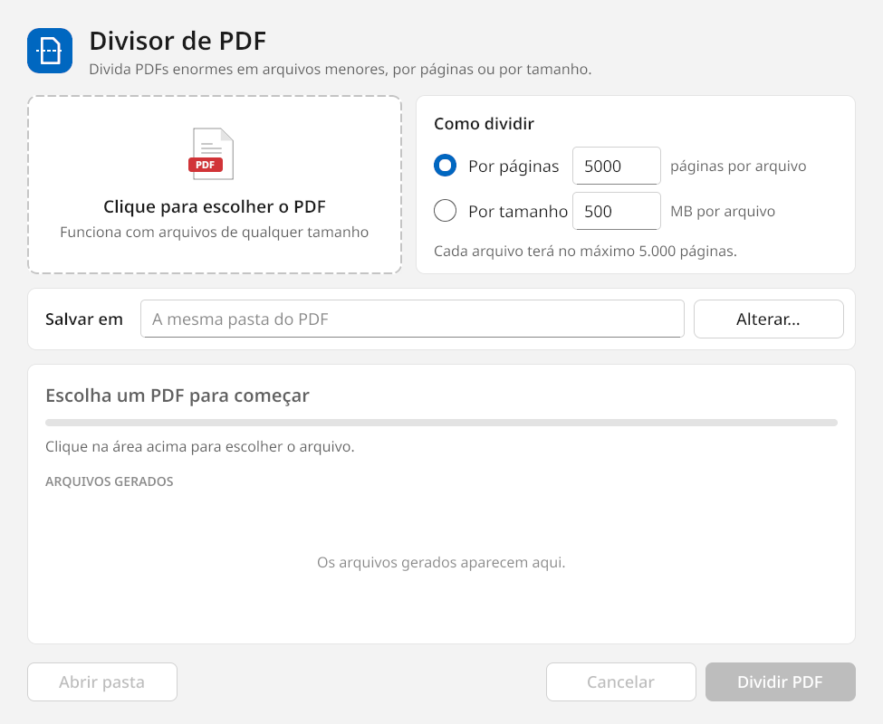

# Divisor de PDF

Divide PDFs enormes em arquivos menores, **por número de páginas** ou **por tamanho máximo em MB**.
Funciona com arquivos de vários gigabytes, num executável único, sem instalação, para **Windows** e **Linux** (Wayland/X11).



## Por que existe

Sistemas de envio de documentos (peticionamento eletrônico, e-mail, portais) costumam limitar o tamanho ou o número de páginas de cada arquivo.
Autos de processo, digitalizações e relatórios passam fácil de 30 mil páginas ou de alguns GB.
As ferramentas comuns ou travam ao abrir arquivos assim ou exigem upload para algum site.
O Divisor de PDF roda localmente e não carrega o PDF inteiro na memória.

| PDF | Páginas | Tempo | Memória usada |
|---|---:|---:|---:|
| Processo de 698 MB | 33.824 | 4,5 s | ~260 MB |
| PDF de teste de 4 GB | 60.000 | ~21 s | ~535 MB |

*Medido num notebook Linux com SSD. O tempo é dominado pela velocidade do disco.*

## Como usar

1. Abra o programa. No Windows, também dá para arrastar o PDF sobre o ícone do `DivisorPDF.exe`.
2. Escolha o PDF.
3. Escolha como dividir:
   - **Por páginas**: cada arquivo terá no máximo N páginas (padrão: 5.000);
   - **Por tamanho**: cada arquivo terá no máximo N MB. Por exemplo, um PDF de 1.000 MB com limite de 500 MB vira 2 ou 3 arquivos: as páginas não são cortadas ao meio, então a divisão nunca fica exata.
4. Confira a pasta de saída (padrão: a mesma do PDF) e clique em **Dividir PDF**.

Os arquivos saem como `nome_parte01_p1-5000.pdf`, `nome_parte02_p5001-10000.pdf` e assim por diante.
Arquivos com o mesmo nome na pasta de saída são substituídos.
Durante a divisão o programa mostra a etapa, a porcentagem, o tempo decorrido, uma estimativa do tempo restante e cada arquivo assim que fica pronto.

### Quando algo dá errado

- Erros aparecem na própria janela em português, com a causa provável e o que fazer: arquivo que não é PDF, PDF protegido por senha, arquivo aberto em outro programa, disco cheio, sem permissão na pasta. Os detalhes técnicos ficam em **Mostrar detalhes técnicos**.
- Antes de começar, o programa confere o espaço livre em disco.
- Se uma página sozinha já passar do limite de MB, ela sai num arquivo próprio, marcado com aviso na lista.
- Cada execução fica registrada em:
  - Windows: `%LOCALAPPDATA%\DivisorPDF\divisor.log`
  - Linux: `~/.cache/DivisorPDF/divisor.log`
- Se o programa fechar inesperadamente, o motivo é gravado e mostrado na próxima vez que ele abrir.

## Download

Baixe a versão mais recente em [Releases](../../releases):

- **Windows 10/11**: `DivisorPDF.exe`. Basta abrir, não precisa instalar.
- **Linux (x86-64)**: `divisor-pdf`. Rode `chmod +x divisor-pdf && ./divisor-pdf`.

### Instalar no Omarchy (ou outro Linux)

```bash
./instalar-omarchy.sh
```

O script põe o binário em `~/.local/bin`, cria o atalho no menu de aplicativos (Super + Espaço → *Divisor de PDF*) e associa o programa a arquivos PDF.
Para a janela abrir flutuando no Hyprland, acrescente ao `hyprland.conf`:

```
windowrule = float, class:^(divisor-pdf)$
```

## Como funciona

A maioria das bibliotecas de PDF lê o arquivo inteiro para a memória antes de mexer nele: um PDF de 700 MB chega a ocupar 2,4 GB de RAM.
Em arquivos de vários GB isso deixa o computador lento ou derruba o programa.

O Divisor de PDF tem um motor próprio de **cópia direta** ([`divisor/motor_direto.go`](divisor/motor_direto.go)):

1. Lê só a tabela de referências cruzadas (xref) e a árvore de páginas.
2. Para cada parte, descobre os objetos que as páginas usam (conteúdo, imagens, fontes), sem seguir links para outras páginas.
3. Copia esses objetos **byte a byte** do arquivo original para o novo, mantendo a numeração. Imagens e conteúdo nunca são descomprimidos nem passam inteiros pela memória.
4. Só regrava o que precisa mudar: as páginas (ganham um novo pai e os atributos herdados), a árvore de páginas e o catálogo. Os dicionários pequenos são comprimidos em *object streams*.

No modo por tamanho, o tamanho de cada página é calculado a partir dos bytes reais dos objetos, então as partes ficam logo abaixo do limite.
Se mesmo assim uma parte passar, ela é refeita com menos páginas.

Formatos suportados: xref clássica e em stream, *object streams*, atualizações incrementais e PDFs linearizados.
Quando a xref está danificada, o programa a reconstrói varrendo o arquivo, como fazem os leitores de PDF.
Os poucos casos que o motor direto não trata, como PDFs criptografados com *object streams*, vão para um motor completo baseado no [pdfcpu](https://github.com/pdfcpu/pdfcpu), limitado a arquivos de até 1 GB.

**O que não vai para as partes:** marcadores (sumário lateral), campos de formulário interativos e a árvore de estrutura de acessibilidade, porque eles referenciam o documento inteiro.
O conteúdo visual das páginas é preservado integralmente.
Links para páginas que ficaram em outra parte deixam de funcionar.

## Desenvolvimento

Requer Go 1.27+.

```
divisor/            motor de divisão (Go puro, multiplataforma)
  motor_direto.go     cópia direta de objetos: partes, árvore de páginas, xref
  pdf_arquivo.go      leitura: xref, object streams, reconstrução
  pdf_lexico.go       interpretação e escrita de objetos PDF
  motor_pdfcpu.go     motor completo (reserva), baseado no pdfcpu
main.go, tela.go    interface (Gio)
visual.go           componentes visuais
sistema_*.go        diálogos nativos, espaço em disco, gerenciador de arquivos
registro.go         log, registro de falhas e mensagens de erro
```

```bash
./build.sh            # gera DivisorPDF.exe e divisor-pdf
./build.sh windows    # só o .exe (Go puro: compila a partir do Linux)
./build.sh linux      # só o Linux (cgo; precisa de wayland, libxkbcommon e mesa)

go test ./divisor                       # testes rápidos (com qpdf instalado, valida cada parte gerada)
go test -tags novulkan .                # testes da interface
DIVISOR_PDF=/caminho/grande.pdf go test ./divisor -run Real -v         # teste com um PDF real
DIVISOR_CONFERIR=1 DIVISOR_PDF=... go test ./divisor -run Real -v      # e compara o render das páginas (Ghostscript)
```

A interface usa o [Gio](https://gioui.org). No Windows, os diálogos de arquivo, o progresso na barra de tarefas e o arrastar-e-soltar usam a API nativa via [windigo](https://github.com/rodrigocfd/windigo).
No Linux, o seletor de arquivos usa o portal do desktop (xdg-desktop-portal).
